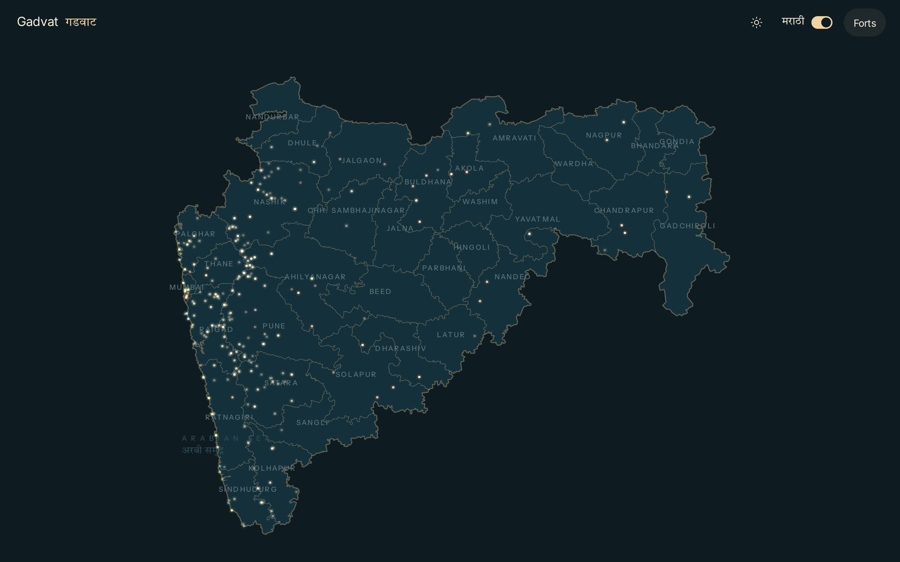
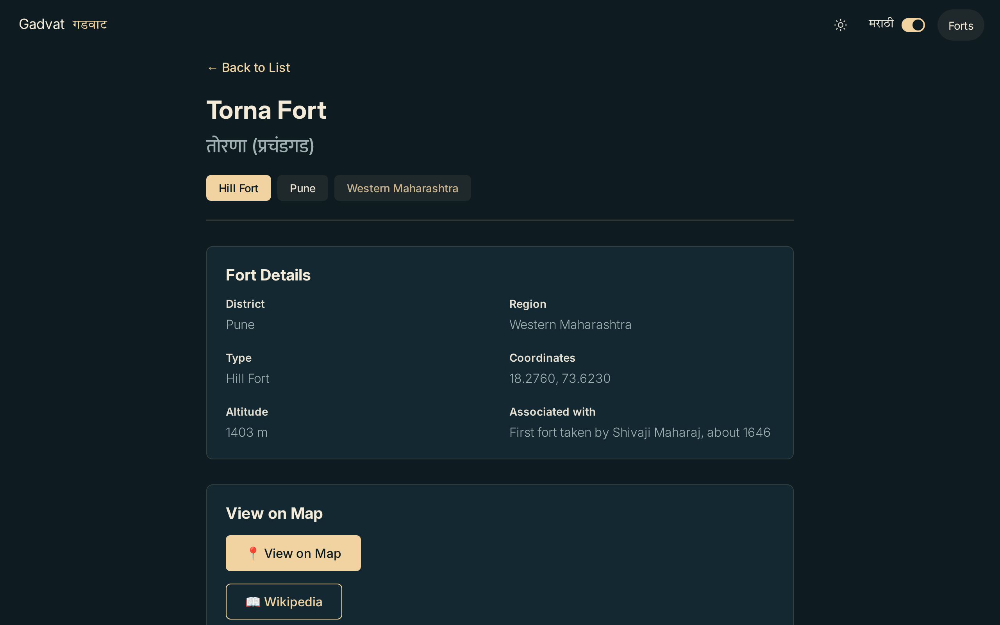

# Gadvat · गडवाट

An open, interactive atlas of the forts of Maharashtra, on one map, in English and Marathi.

**महाराष्ट्रातील गडकोट, एका नकाशावर.**

**Live site → [doublepoetry.github.io/gadvat-new](https://doublepoetry.github.io/gadvat-new/)** _(goes live with the first deploy)_




## What's here

- 267 forts (hill, sea, coastal and land forts) on one map, with type, district and region
- Search by name in English or Marathi, and filter by district and fort type
- A page for every fort, with directions on Google Maps and a Wikipedia link
- English and Marathi, and light and dark modes
- Forts whose location is still unknown are listed but left off the map

## Help make it better

Gadvat grows through contributions, and every change is reviewed before it goes live.

**No GitHub experience needed:** [open an issue](https://github.com/Doublepoetry/gadvat-new/issues/new/choose) and pick a form:

| Form                 | Use it to                                               |
| -------------------- | ------------------------------------------------------- |
| **Add history**      | add facts, events or people, with your sources          |
| **Add photos**       | suggest photos from Wikimedia Commons for a fort        |
| **Fix fort details** | correct a wrong location, name, type or district        |
| **Suggest a route**  | share a trek route: base village, time, difficulty, GPX |

You need a free GitHub account to open an issue.

**Comfortable with git?** Each fort is one Markdown file in [`forts/`](forts/). Edit it and open a pull request; CI checks the data for you. See [CONTRIBUTING.md](CONTRIBUTING.md) for the steps and [docs/FORT_SCHEMA.md](docs/FORT_SCHEMA.md) for every field.

## Data sources

- **Forts:** the original [Gadvat](https://github.com/Doublepoetry/Gadvat) dataset, corrected by contributors. Each fort links to its Wikipedia article for further reading.
- **Addresses and map tiles:** [OpenStreetMap](https://www.openstreetmap.org/copyright), © OpenStreetMap contributors, available under the [ODbL](https://opendatacommons.org/licenses/odbl/).
- **Photos:** [Wikimedia Commons](https://commons.wikimedia.org); each photo shows its author and licence.

## Licence

- Code: [MIT](LICENSE)
- Data and content (`forts/`, `src/data/`): [CC BY-SA 4.0](CONTENT-LICENSE.md)

## Development

Built with SvelteKit, Svelte 5, TypeScript and Leaflet. Fort files are compiled to JSON at build time, so the site needs no server or database. See [docs/ARCHITECTURE.md](docs/ARCHITECTURE.md).

Needs Node.js 24.

```bash
npm install
npm run build-data   # forts/*.md → src/data/forts.json
npm run dev          # http://localhost:5173
```

Before opening a pull request:

```bash
npm run lint && npm run check && npm test
```
